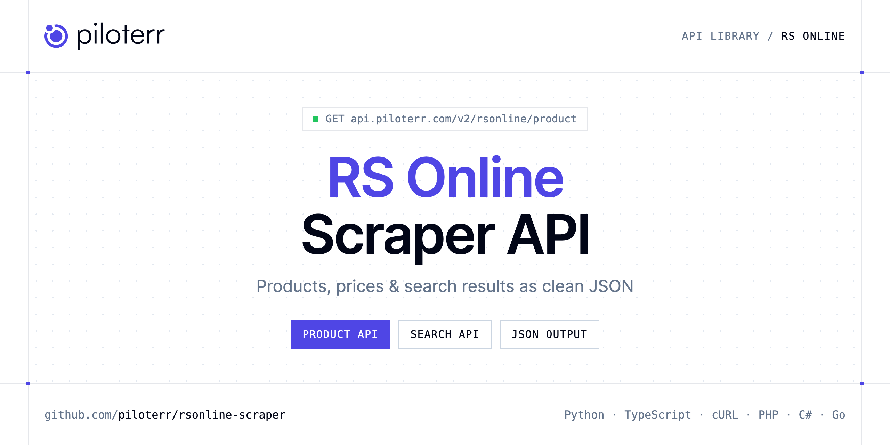

<p align="center">
  <a href="https://www.piloterr.com"></a>
</p>

# RS Online Scraper API

[](https://discord.gg/CFj3ph8aHU) [](https://app.piloterr.com) [](https://app.piloterr.com/openapi) [](LICENSE)

The **Piloterr RS Online Scraper API** lets you extract public data from RS Online as **clean, structured JSON** — no proxies, headless browsers or HTML parsing to maintain. Endpoints available in production:

- **RS Online Product API** — Read one RS Online UK product URL, including the RS stock number, manufacturer part, and pound price.
- **RS Online Search API** — Search RS Online UK by keyword or category.

Use it for price monitoring, assortment tracking, competitor analysis, product research or catalog enrichment.

| Endpoint | Path | Credits | What you get |
|---|---|---|---|
| [RS Online Product API](#rs-online-product-api) | `/v2/rsonline/product` | 2 | Read one RS Online UK product URL, including the RS stock number, manufacturer part, and pound price. |
| [RS Online Search API](#rs-online-search-api) | `/v2/rsonline/search` | 2 | Search RS Online UK by keyword or category. Pound prices keep the amount printed on the page. |

## Table of contents

- [How it works](#how-it-works)
- [RS Online Product API](#rs-online-product-api)
- [RS Online Search API](#rs-online-search-api)
- [Code examples in other languages](#code-examples-in-other-languages)
- [Practical use cases](#practical-use-cases)
- [Why Piloterr?](#why-piloterr)
- [FAQ](#faq)
- [Related scrapers](#related-scrapers)
- [Support](#support)

## How it works

1. **Create a free Piloterr account** and copy your API key from the [dashboard](https://app.piloterr.com).
2. **Send a `GET` (or `POST`) request** to `https://api.piloterr.com/v2/...` with the header `x-api-key: YOUR_API_KEY`.
3. **Receive structured JSON** — Piloterr handles rendering, proxies, retries and parsing.

```bash
export PILOTERR_API_KEY="your-api-key"
pip install requests        # Python
# TypeScript: Node.js 18+ (native fetch), run with `npx tsx file.ts`
```

> Every endpoint accepts both `GET` (query string) and `POST` (JSON body with the same fields).

## RS Online Product API

Read one RS Online UK product URL, including the RS stock number, manufacturer part, and pound price.

`GET | POST https://api.piloterr.com/v2/rsonline/product` · **2 credits per request** · [Full reference](https://app.piloterr.com/openapi)

### Request parameters

| Parameter | Type | Required | Description |
|---|---|---|---|
| `query` | string | ✅ | A uk.rs-online.com product link. The response is one flat product. price is the numeric pound amount and price_display is the printed string. A search link, a bare stock number, or another host returns 400. |
| `return_page_source` | boolean | — | Default false. true replaces the product object with result, the rendered HTML. |

### Python example

```python
import json
import os
import requests

response = requests.get(
    "https://api.piloterr.com/v2/rsonline/product",
    headers={"x-api-key": os.environ["PILOTERR_API_KEY"]},
    params={
        "query": "https://uk.rs-online.com/web/p/splice-connectors/0303327",
    },
    timeout=120,
)
response.raise_for_status()
data = response.json()

print(json.dumps(data, indent=2, ensure_ascii=False)[:2000])
```

### TypeScript example

```typescript
type RsOnlineProduct = {
  mpn?: string;
  url?: string;
  brand?: string;
  price?: number;
  title?: string;
  images?: string[];
  category?: string;
  currency?: string;
  in_stock?: boolean;
  brand_url?: string;
  image_url?: string;
  pack_size?: number;
  categories?: string[];
  product_id?: string;
  description?: string;
  rohs_status?: string;
  price_breaks?: {
    price?: number;
    quantity?: number;
    price_display?: string;
    indicative_price?: number;
    indicative_price_display?: string;
  }[];
  stock_status?: string;
  datasheet_url?: string;
  price_display?: string;
  specifications?: {
    name?: string;
    value?: string;
  }[];
  rs_stock_number?: string;
  unit_of_measure?: string;
  minimum_order_qty?: number;
};

const params = new URLSearchParams({
  "query": "https://uk.rs-online.com/web/p/splice-connectors/0303327",
});

const response = await fetch(`https://api.piloterr.com/v2/rsonline/product?${params}`, {
  headers: { "x-api-key": process.env.PILOTERR_API_KEY! },
});
if (!response.ok) throw new Error(`Piloterr error ${response.status}: ${await response.text()}`);

const data = (await response.json()) as RsOnlineProduct;

console.log(JSON.stringify(data, null, 2).slice(0, 2000));
```

<details>
<summary><b>POST variant</b></summary>

```http
POST https://api.piloterr.com/v2/rsonline/product
x-api-key: YOUR_API_KEY
Content-Type: application/json

{"query": "https://uk.rs-online.com/web/p/splice-connectors/0303327"}
```
</details>

### Output example

Example response from the API reference, abridged — real values depend on the page you scrape.

```json
{
  "mpn": "221-2401",
  "url": "https://uk.rs-online.com/web/p/splice-connectors/0303327",
  "brand": "WAGO",
  "price": 4.95,
  "title": "WAGO, 221 Wire Splice Splice Connector, Clear, Insulated 12 AWG",
  "images": [
    "https://media.rs-online.com/t_large/Y0303327-01.jpg",
    "https://media.rs-online.com/t_thumb/Y0303327-01.jpg"
  ],
  "category": "Splice Connectors",
  "currency": "GBP",
  "in_stock": true,
  "brand_url": "https://uk.rs-online.com/web/b/wago",
  "image_url": "https://media.rs-online.com/t_large/Y0303327-01.jpg",
  "pack_size": 10,
  "categories": [
    "Electronic Components, Power & Connectors",
    "Connectors"
  ],
  "product_id": "0303327",
  "description": "The Wago inline splicing connector with levers (2-conductor, maximum 4 mm²) features tool-free connection for solid, stranded, and fine-s…",
  "rohs_status": "EXEMPT",
  "price_breaks": [
    {
      "price": 4.95,
      "quantity": 1,
      "price_display": "£4.95",
      "indicative_price": 0.495,
      "indicative_price_display": "£0.495"
    },
    {
      "price": 4.56,
      "quantity": 5,
      "price_display": "£4.56",
      "indicative_price": 0.456,
      "indicative_price_display": "£0.456"
    }
  ],
  "stock_status": "In Stock",
  "datasheet_url": "https://docs.rs-online.com/54b0/A700000012773609.pdf",
  "price_display": "£4.95",
  "specifications": [
    {
      "name": "Brand",
      "value": "WAGO"
    },
    {
      "name": "Splice Type",
      "value": "Wire Splice"
    }
  ],
  "rs_stock_number": "030-3327",
  "unit_of_measure": "1 Pack of 10",
  "minimum_order_qty": 1
}
```

### Response fields

| Field | Type | Description |
|---|---|---|
| `mpn` | string |  |
| `url` | string |  |
| `brand` | string |  |
| `price` | number |  |
| `title` | string |  |
| `images` | string[] |  |
| `category` | string |  |
| `currency` | string |  |
| `in_stock` | boolean |  |
| `brand_url` | string |  |
| `image_url` | string |  |
| `pack_size` | integer |  |
| `categories` | string[] |  |
| `product_id` | string |  |
| `description` | string |  |
| `rohs_status` | string |  |
| `price_breaks[]` | object[] |  |
| `price_breaks[].price` | number |  |
| `price_breaks[].quantity` | integer |  |
| `price_breaks[].price_display` | string |  |
| `price_breaks[].indicative_price` | number |  |
| `price_breaks[].indicative_price_display` | string |  |
| `stock_status` | string |  |
| `datasheet_url` | string |  |
| `price_display` | string |  |

## RS Online Search API

Search RS Online UK by keyword or category. Pound prices keep the amount printed on the page.

`GET | POST https://api.piloterr.com/v2/rsonline/search` · **2 credits per request** · [Full reference](https://app.piloterr.com/openapi)

### Request parameters

| Parameter | Type | Required | Description |
|---|---|---|---|
| `query` | string | ✅ | A keyword, or a uk.rs-online.com search or category link. Empty, another host, or a product link returns 400. A keyword builds /web/c/?searchTerm=... and page 1 omits pn. Each card has price as a number and price_display… |
| `page` | number | — | Page number starting at 1. Omit it for page 1. Page 2 sets pn=2, changes pagination.page, and returns the next cards. pagination.next is that next URL, or null on the last page. A value below 1 returns 400. |
| `return_page_source` | boolean | — | Default false. true replaces results and pagination with result, the rendered HTML. |

### Python example

```python
import json
import os
import requests

response = requests.get(
    "https://api.piloterr.com/v2/rsonline/search",
    headers={"x-api-key": os.environ["PILOTERR_API_KEY"]},
    params={
        "query": "connector",
    },
    timeout=120,
)
response.raise_for_status()
data = response.json()

print(json.dumps(data, indent=2, ensure_ascii=False)[:2000])
```

### TypeScript example

```typescript
type RsOnlineSearch = {
  results?: {
    mpn?: string;
    url?: string;
    brand?: string;
    price?: number;
    title?: string;
    category?: string;
    currency?: string;
    in_stock?: boolean;
    image_url?: string;
    pack_size?: number;
    product_id?: string;
    stock_status?: string;
    price_display?: string;
    rs_stock_number?: string;
    minimum_order_qty?: number;
  }[];
  pagination?: {
    next?: string;
    page?: number;
    per_page?: number;
    total_pages?: number;
    total_results?: number;
  };
};

const params = new URLSearchParams({
  "query": "connector",
});

const response = await fetch(`https://api.piloterr.com/v2/rsonline/search?${params}`, {
  headers: { "x-api-key": process.env.PILOTERR_API_KEY! },
});
if (!response.ok) throw new Error(`Piloterr error ${response.status}: ${await response.text()}`);

const data = (await response.json()) as RsOnlineSearch;

console.log(JSON.stringify(data, null, 2).slice(0, 2000));
```

<details>
<summary><b>POST variant</b></summary>

```http
POST https://api.piloterr.com/v2/rsonline/search
x-api-key: YOUR_API_KEY
Content-Type: application/json

{"query": "connector"}
```
</details>

### Output example

Example response from the API reference, abridged — real values depend on the page you scrape.

```json
{
  "results": [
    {
      "mpn": "221-2401",
      "url": "https://uk.rs-online.com/web/p/splice-connectors/0303327",
      "brand": "WAGO",
      "price": 4.95,
      "title": "WAGO, 221 Wire Splice Splice Connector, Clear, Insulated 12 AWG",
      "category": "Splice Connectors",
      "currency": "GBP",
      "in_stock": true,
      "image_url": "https://media.rs-online.com/t_large/Y0303327-01.jpg",
      "pack_size": 10,
      "product_id": "0303327",
      "stock_status": "IN_STOCK",
      "price_display": "£4.95",
      "rs_stock_number": "030-3327",
      "minimum_order_qty": 1
    }
  ],
  "pagination": {
    "next": "https://uk.rs-online.com/web/c/?searchTerm=connector&pn=2",
    "page": 1,
    "per_page": 20,
    "total_pages": 3220,
    "total_results": 64395
  }
}
```

### Response fields

| Field | Type | Description |
|---|---|---|
| `results[]` | object[] |  |
| `results[].mpn` | string |  |
| `results[].url` | string |  |
| `results[].brand` | string |  |
| `results[].price` | number |  |
| `results[].title` | string |  |
| `results[].category` | string |  |
| `results[].currency` | string |  |
| `results[].in_stock` | boolean |  |
| `results[].image_url` | string |  |
| `results[].pack_size` | integer |  |
| `results[].product_id` | string |  |
| `results[].stock_status` | string |  |
| `results[].price_display` | string |  |
| `results[].rs_stock_number` | string |  |
| `results[].minimum_order_qty` | integer |  |
| `pagination` | object |  |
| `pagination.next` | string |  |
| `pagination.page` | integer |  |
| `pagination.per_page` | integer |  |
| `pagination.total_pages` | integer |  |
| `pagination.total_results` | integer |  |

## Code examples in other languages

Ready-to-run examples live in the [`examples/`](examples) folder. Each one reads your key from the `PILOTERR_API_KEY` environment variable.

| Language | Product | Search |
|---|---|---|
| cURL (Bash) | [`product`](examples/curl/product.sh) | [`search`](examples/curl/search.sh) |
| PHP | [`product`](examples/php/product.php) | [`search`](examples/php/search.php) |
| C# | [`product`](examples/csharp/Product.cs) | [`search`](examples/csharp/Search.cs) |
| Go | [`product`](examples/go/product.go) | [`search`](examples/go/search.go) |
| Java | [`product`](examples/java/ProductExample.java) | [`search`](examples/java/SearchExample.java) |
| Ruby | [`product`](examples/ruby/product.rb) | [`search`](examples/ruby/search.rb) |
| Node.js | [`product`](examples/nodejs/product.mjs) | [`search`](examples/nodejs/search.mjs) |

## Practical use cases

- **Price monitoring** — Track prices, promotions and availability over time to react to competitors.
- **Assortment & catalog tracking** — Follow new products, delisted items and category changes.
- **Competitor analysis** — Benchmark ranges, brands and positioning across retailers.
- **Product research** — Spot best-sellers and trends from search results.
- **Catalog enrichment** — Pull titles, images and attributes into your PIM or marketplace listings.

## Why Piloterr?

- **No infrastructure** — no proxies, headless browsers or CAPTCHA solving to run yourself.
- **Structured JSON** — stable, documented fields instead of brittle HTML selectors.
- **Pay per request** — transparent credit cost per endpoint, failed requests are retried for you.
- **One API key, hundreds of sources** — RS Online plus many other e-commerce, search and company data endpoints in the [Piloterr library](https://www.piloterr.com/library).
- **Any language** — plain HTTPS + JSON, with examples for Python, TypeScript, cURL, PHP, C#, Go, Java, Ruby and Node.js.

## FAQ

### Is it legal to scrape RS Online?

Collecting publicly available data is generally allowed in many jurisdictions, but rules depend on your country, the data you collect and how you use it. Avoid personal data unless you have a lawful basis, respect the website's terms where they apply, and get legal advice for your specific use case. This is not legal advice.

### Do I need proxies or a headless browser?

No. Piloterr handles rendering, proxy rotation and retries on its side. You only send an HTTPS request with your `x-api-key` header and receive JSON.

### How much does a request cost?

Credits per call: `/v2/rsonline/product` **2**, `/v2/rsonline/search` **2**. See the [Piloterr website](https://www.piloterr.com) for plans.

### What data does the RS Online API return?

Each endpoint returns structured JSON: **RS Online Product** — `mpn`, `url`, `brand`, `price`, `title`, `images`; **RS Online Search** — `results[]`, `results[].mpn`, `results[].url`, `results[].brand`, `results[].price`, `results[].title`.

### How do I paginate RS Online results?

Use the `page` parameter and keep requesting while the response indicates more results.

### Can I get the raw HTML instead of JSON?

Yes. Set `return_page_source=true` and the response becomes `{"result": "..."}` with the page source.

### Which languages are supported?

Any language that can make an HTTP request. This README shows Python and TypeScript; the [`examples/`](examples) folder contains cURL, PHP, C#, Go, Java, Ruby and Node.js.

## Related scrapers

- [About You Scraper API](https://github.com/piloterr/aboutyou-scraper)
- [Action Scraper API](https://github.com/piloterr/action-scraper)
- [Aldi Scraper API](https://github.com/piloterr/aldi-scraper)
- [Alibaba Scraper API](https://github.com/piloterr/alibaba-scraper)
- [AliExpress Scraper API](https://github.com/piloterr/aliexpress-scraper)
- [Allegro Scraper API](https://github.com/piloterr/allegro-scraper)
- [All Piloterr scrapers on GitHub](https://github.com/piloterr)

## Support

- 💬 Join the [Piloterr Discord](https://discord.gg/CFj3ph8aHU) to ask questions and share what you build.
- 📚 Browse the [API reference (OpenAPI)](https://app.piloterr.com/openapi) and the [Piloterr library](https://www.piloterr.com/library).
- 🔑 [Get your API key](https://app.piloterr.com).

---

<p align="center">
  <a href="https://www.piloterr.com">
    <picture>
      <source media="(prefers-color-scheme: dark)" srcset="images/logo-dark.svg">
      
    </picture>
  </a>
  <br>
  <sub>Built by <a href="https://www.piloterr.com">Piloterr</a> — web scraping APIs for e-commerce, search, real estate and more, one API key.</sub>
</p>

<sub>RS Online is a trademark of its respective owner. This repository is not affiliated with or endorsed by RS Online. Examples are released under the MIT license.</sub>
